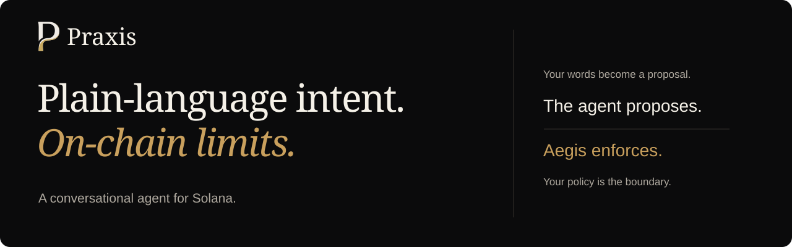
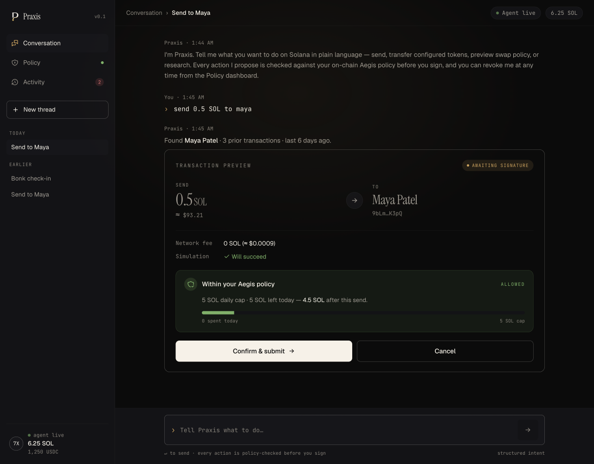

<p align="center">
  
</p>

<p align="center">
  <strong>Delegate a little spending power. Not your whole wallet.</strong><br>
  Describe an action. Inspect the proposal. Let Aegis enforce the limits.
</p>

<p align="center">
  <a href="https://app.usepraxis.fun">Try the devnet app</a> ·
  <a href="#run-it-locally">Run locally</a> ·
  <a href="docs/GUIDE.md">User guide</a> ·
  <a href="docs/ARCHITECTURE.md">Architecture</a> ·
  <a href="sdk/README.md">SDK</a>
</p>

---

## Your intent, with a boundary

**Praxis is a conversational Solana agent with an on-chain spending policy.**
Send SOL, transfer a configured token, research assets, and prepare recurring
stock-token transfers in plain English. Every executable proposal shows its
recipient, amount, simulation, and policy verdict before you confirm it.

The difference is **Aegis**, the Anchor program behind the vault. You fund a
separate vault and give the agent a scoped key. Aegis checks that key, spending
caps, recipient restrictions, expiry, and pause state before funds move.
An LLM can misunderstand you; it cannot change those on-chain limits.

Praxis is for wallet owners who want bounded delegation, and developers who
want to build on the same proposal-and-policy workflow through a typed SDK.
It is not an unrestricted wallet assistant or an autonomous trading bot.



*Actual local mock-mode UI. Balances, prices, addresses, and simulation results
are fixtures; this screenshot is not evidence of an on-chain transaction.*

### What makes it useful

| Capability | What you get |
| --- | --- |
| **Intent you can inspect** | Typed proposals rather than opaque transaction bytes; ambiguous recipients trigger a question. |
| **Limits outside the model** | Independent SOL and single-mint token caps, a rolling 24-hour spend window, optional recipient allow-list, and expiry enforced by Aegis. |
| **Owner control** | Wallet-signed funding, policy changes, withdrawal, key rotation, and revocation. Revoke clears the agent authority and pauses the policy. |
| **A visible outcome** | Proposal status, activity history, transaction links, and a fixed-size on-chain log of allowed actions. |
| **A parser that degrades gracefully** | Configurable Gemini/Groq parsing with deterministic local fallback; optional browser-held model keys. |
| **The same workflow in code** | A Node-first SDK for sign-in, conversations, proposals, research, schedules, and wallet-signed owner transactions. |

## From a sentence to a transaction

```text
"send 0.5 SOL to maya"
          │
          ▼
Parse intent → resolve recipient → simulate → show proposal
                                                  │
                                           You confirm
                                                  │
                                                  ▼
Scoped agent signs → Aegis checks the live policy → vault transfers
```

**Confirmation is not another owner-wallet signature.** In API mode, your
authenticated session authorizes the backend to use its scoped agent key.
Your wallet signs owner actions such as changing limits. Protect the session
as a spending credential: someone holding it can request transfers within the
envelope. Aegis remains the boundary even if the backend is compromised.

Read the [trust model](docs/ARCHITECTURE.md#trust-boundaries) before using real
value. Policy enforcement does not guarantee that an action is a good idea,
that a recipient is trustworthy, or that an issuer cannot freeze a token.

## Run it locally

You need **Bun** and **Node.js 20.9+**. No wallet, RPC, model key, database,
or Rust toolchain is needed for the mock experience.

```bash
git clone https://github.com/0xuser64bit/Praxis.git
cd Praxis
bun install --frozen-lockfile
(cd sdk && bun install --frozen-lockfile)
NEXT_PUBLIC_PRAXIS_PROVIDER=mock bun run dev
```

Open **http://localhost:3000/app**. Try these in order:

| Say or do this | What to look for |
| --- | --- |
| `send 0.5 SOL to maya` | A named recipient, a simulated result, and an allowed proposal. Confirm to exercise the mock flow. |
| `send 50 SOL to maya` | A rejection against the 5 SOL daily budget, not a larger transfer. |
| `send 0.1 SOL to alex` | A clarifying question: the seeded address book has two Alexes. |
| `swap 100 usdc for jup` | A blocked preview. Swaps cannot execute. |
| Open **Policy** → **Revoke agent**, then request another send | Revocation blocks the next action. |

Mock state resets on reload and never touches Solana. Stock flows need API
mode. To move devnet SOL, follow [local API setup](docs/DEPLOY.md#local-api-mode-on-devnet),
then the [first-transfer walkthrough](docs/GUIDE.md#your-first-devnet-transfer).

## Stock tokens, without pretending to be a trading venue

With `PRAXIS_STOCKS_ENABLED=1`, Praxis adds a pinned eight-symbol PreStocks
universe: **ANDURIL, ANTHROPIC, FIGUREAI, KALSHI, NEURALINK, OPENAI,
POLYMARKET, and SPACEX**.

```text
research openai                  Read market data and issuer-authority warnings
buy $40 openai                   Propose a quantity using the fetched token price
buy $50 spacex every monday      Schedule proposals; each still needs confirmation
buy ai basket $60                Prepare a basket, or clarify if any leg is blocked
```

> **A “buy” transfers stock tokens you already hold in the guarded vault. It
> does not exchange SOL or USDC for stock.** There is no purchase or swap route.

Only one SPL mint can be active in a policy at a time. Dollar requests become
fixed token quantities when proposed; recurring schedules fix their quantity
at creation, not at each fire. Devnet uses clearly labeled Token-2022 mirror
mints, not real pre-IPO tokens. Issuer powers on real tokens are outside Aegis's
control. [Stock workflow and caveats](docs/GUIDE.md#stock-token-workflows).

## Build on Praxis

The SDK is an authenticated client of a hosted backend, not an agent runtime.
Start with a wallet that already has a funded policy. Use a dedicated devnet
key for local experiments; never paste a primary wallet secret into examples.

```bash
bun add @usepraxis/sdk
```

```ts
import { PraxisClient, keypairSigner } from "@usepraxis/sdk";

const praxis = new PraxisClient({
  baseUrl: process.env.PRAXIS_URL!,
  signer: keypairSigner(process.env.PRAXIS_SECRET_KEY!),
});

await praxis.connect();
const { proposals } = await praxis.ask("send 0.01 SOL to maya");

for (const proposal of proposals) {
  console.log(proposal.id, proposal.detail, proposal.check);
}
```

This example only prepares proposals. After your own review, call
`await praxis.signProposal(proposal.id)` for the selected proposal; that call
can move value. Maya must be a saved contact on that backend.
[SDK setup, authentication, and owner transactions](sdk/README.md).

## Under the hood

**Next.js 16 / React 19 / TypeScript** provide the web app and same-origin API.
**Anchor / Rust** provide Aegis. **Postgres** stores per-wallet application
state; **Redis** provides shared sign-in replay protection and rate limits.
Production agent-key custody can live behind the standalone signer.

| Area | Start here |
| --- | --- |
| Product UI and mock provider | [`components/app/`](components/app/) |
| Landing page and brand | [`components/praxis/`](components/praxis/), [`data/`](data/) |
| API routes and server orchestration | [`app/api/`](app/api/), [`server/`](server/) |
| Policy enforcement and tests | [`aegis/`](aegis/) |
| Shared contract and generated IDL | [`shared/`](shared/) |
| Client and key boundary | [`sdk/`](sdk/), [`signer/`](signer/) |

The configured default program ID is
`3z9GuipayYpAcPnjiwFkfe6gZvfSfuPZgX8djYu67Yhd`.
Verify the target cluster and deployed binary before relying on a deployment;
a source checkout is not an attestation of what's on-chain.

## Know the edges

- **No executable swaps or automatic scheduled execution.** Scheduled fires
  create proposals, not signatures.
- **One token envelope per policy.** Switching the active mint is an owner
  transaction, not a portfolio of independent budgets.
- **Token-2022 has limits.** Active transfer hooks are unsupported; transfer-fee
  tokens can credit the recipient less than the displayed gross amount.
- **Not an audit certification.** The [October 29, 2026 security review](audit_1/REPORT.md)
  documents a bounded source-and-local-test review, its fixes, and its coverage
  gaps. It is not an independent or exhaustive audit.

See [known operational gaps](docs/ARCHITECTURE.md#known-gaps) for concurrency,
indexing, token funding, and scheduler limits.

## Where to go next

| I want to… | Read |
| --- | --- |
| Use the app and understand a proposal | [User guide](docs/GUIDE.md) |
| Run API mode, enable stocks, or host Praxis | [Deployment and operations](docs/DEPLOY.md) |
| Understand accounts, enforcement, and failure modes | [Architecture](docs/ARCHITECTURE.md) |
| Integrate a bot or service | [SDK reference](sdk/README.md) |
| Isolate the agent key | [Signer service](signer/README.md) |
| Make a change and test it | [Contributing](CONTRIBUTING.md) |

## License

The SDK is [MIT-licensed](sdk/LICENSE). This repository does not declare a
root license; do not assume the SDK's license covers the application, signer,
or Aegis program.
