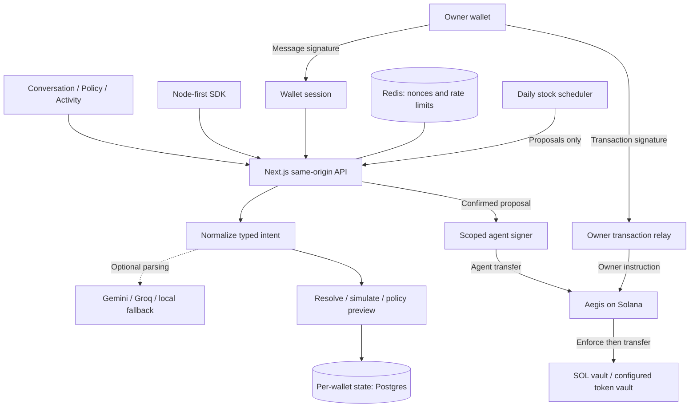

# Architecture

[Home](../README.md) / Architecture · [User guide](GUIDE.md) · [Operations](DEPLOY.md)

**The agent interprets intent. The program enforces the envelope.** Praxis
separates a conversational interface from the authority to move vault funds.
The UI and backend explain the policy; Aegis checks it inside the transaction.

## System map



The signer may be local for development or isolated in a separate service.
Postgres is the production state path; a filesystem repository supports
single-host local development. Research additionally reads RPC, indexer, and
PreStocks data. None of those sources grants transfer authority.

## Runtime modes

`components/app/providerMode.ts` selects the frontend provider:

| Configuration | Development | Production |
| --- | --- | --- |
| `NEXT_PUBLIC_PRAXIS_PROVIDER` unset or unrecognized | Mock | API |
| Explicit `api` | API | API |
| Explicit `mock` | Mock | Disabled unless `NEXT_PUBLIC_PRAXIS_ALLOW_MOCK=1` |

The copied `.env.example` explicitly selects API mode. `NEXT_PUBLIC_*` values
are embedded in the client build; set them before building and rebuild after
changes.

- **Mock:** `components/app/mock/` uses a deterministic parser, seeded contacts,
  fixture research, and in-memory balances. State resets on reload. It does not
  test wallet auth, RPC, persistence, real enforcement, or the stock service.
- **API:** `RemotePraxisProvider` calls `/api/praxis/*`. Each request constructs
  `PraxisServerProvider` from the signed-in wallet and its stored state. The
  policy PDA derives from that wallet, not a user-supplied arbitrary owner.

## Request flow

1. Wallet sign-in creates an HTTP-only session cookie. Redis-backed one-time
   challenge consumption prevents cross-instance replay in production.
2. A conversation turn goes through the configured intent providers (default
   `gemini,groq`), then the deterministic fallback. `PRAXIS_LOCAL_INTENT=1`
   skips the external providers. Provider output is normalized and bounded.
3. Names resolve through the per-wallet off-chain address book. Unknown or
   ambiguous recipients require clarification.
4. The provider builds typed actions, simulates them, and attaches an off-chain
   policy verdict, fee estimate, and proposal state.
5. On confirmation, the provider claims the proposal in durable state and
   prepares a transaction signed by the scoped agent key.
6. Aegis checks the live policy before transferring from the vault. State and
   activity refresh afterward; uncertain confirmation is reconciled by signature.

The browser-held-key path calls Gemini or Groq directly from the browser,
stores the model key in local storage, and sends only parsed intent to Praxis.
The server normalizes it through the same checks. Browser parsing failure can
fall back to shared parsing, with a visible fallback message.

Proposals have a **seven-day freshness limit** (`PROPOSAL_TTL_SECONDS` in
`server/provider/praxisServer.ts`). Quantities remain fixed. Fees, simulation,
remaining budget, and dollar equivalents can become stale; the preview does
not reserve funds or override execution-time enforcement.

## On-chain model (Aegis)

Source: [`aegis/programs/aegis/src/`](../aegis/programs/aegis/src/).

| Account | Derivation / purpose |
| --- | --- |
| Policy PDA | `["policy", owner]`; owner, agent authority, caps, expiry, pause, lists, spend counters, and one SPL envelope |
| SOL vault PDA | `["vault", policy]`; system-owned, zero-data account controlled through program-derived signatures |
| Token vault | The vault PDA's associated token account for the configured mint and token program |
| Action log PDA | `["action_log", policy]`; fixed-size ring buffer of allowed actions, including their mint |

### Agent instructions

- `agent_transfer` transfers native SOL.
- `agent_transfer_spl` transfers the configured SPL Token or Token-2022 mint.

Both require a nonzero amount, the registered agent signer, an unpaused and
unexpired policy, available per-transfer and daily budget, and a permitted
recipient when the recipient list is nonempty. An empty recipient list is
unrestricted. A cap boundary is inclusive: spending exactly the limit is
allowed.

The **daily window is a 24-hour bucket**, reset on a qualifying transfer after
the previous window elapses. It is neither a midnight reset nor a sliding
24-hour sum. SOL and token counters are separate. Updating caps preserves the
existing spend; changing the configured token mint starts a new token window.

The SPL path additionally validates the configured mint, source/destination
token programs and mint fields, and vault authority. Recipient restrictions
refer to the destination token account's internal owner. Token accounts are
parsed and `TransferChecked` is built directly, without `anchor-spl`.
The token program revalidates the mint and decimals during CPI.

The SOL vault keeps the runtime-required rent reserve on agent transfers. The
owner can withdraw to a rent-exempt remainder or sweep to zero. The agent
cannot close the vault.

### Owner instructions

`initialize_policy`, `fund_vault`, `withdraw_vault`, `update_policy`,
`configure_token`, `revoke_agent`, `rotate_agent`, and `close_policy` require
owner authority. Owner actions are not constrained by agent spending caps.

Revocation sets pause and clears agent authority. Rotation registers a new key
and unpauses. Merely unpausing after revoke does not restore the old key.
`withdraw_vault` withdraws SOL; it is not a general SPL withdrawal instruction.

### Token and swap boundaries

The single configured token mint is the enforced token allow-list. The stored
`allowed_programs` and multi-entry `allowed_mints` vectors are **not a general
on-chain permission system for arbitrary CPIs**. There is no `agent_swap` and
no Jupiter CPI. Swap previews are always blocked, even if an off-chain
allow-list or quote looks acceptable.

Token-2022 transfer hooks requiring additional accounts are unsupported and
revert. Transfer fees can reduce the recipient's net credit; the cap bounds
the gross vault debit and the UI does not yet display that net amount.
Off-chain `checkMintMovable` verifies the mint's existence and token program
before proposing transfers. Never enable `PRAXIS_ALLOW_UNVERIFIED_MINTS` on a
real deployment to hide a cluster/mint mismatch.

## Concurrency and state

Source: `server/provider/`. Each request loads a per-wallet document with a
monotonic revision. Postgres saves use compare-and-swap; stale writers fail
with a conflict and must reload and re-decide. Threads, contacts, schedules,
and execution state share that document, so even a stale conversation write
must not overwrite newer transfer claims. The execution path is simplified
below; proposals can also be created in `blocked` state.

```text
pending → signing → submitted → signed
   │          │          └────→ blocked (known failure or expired unseen tx)
   └→ cancelled
              └→ pending (failure before submission only)
```

- **Proposal claims:** the `pending` → `signing` transition is saved before
  execution. Only a winning revision may proceed. This guards concurrent
  confirmations; it is not an unconditional end-to-end “exactly once” promise.
- **Unknown outcomes:** the signature and last valid block height are stored
  as `submitted` before sending. Lost confirmation leaves the proposal there,
  not back in `pending`. Later reads reconcile the signature; an unseen
  transaction is blocked only after its validity window has passed.
- **Schedule claims:** advance `nextFireTs` before building a proposal.
  A crash between claim and proposal can miss a fire rather than duplicate it.
- **Local serialization:** a per-wallet async mutex serializes relevant actions
  within an instance. Filesystem revision checks are not a distributed lock;
  use Postgres for multi-instance deployments.

Postgres schema creation is lazy (`server/provider/migrations/0001_init.sql`).
The default remote SQL driver is Neon; local URLs select `pg`. Set
`PRAXIS_PG_DRIVER=pg` for an ordinary remote Postgres server that does not
support Neon's HTTP transport.

## Stocks (PreStocks)

Source: `server/stocks/`. `PRAXIS_STOCKS_ENABLED=1` merges the pinned universe
into the token catalog; `PRAXIS_STOCK_UNIVERSE` filters its presentation.
`PRAXIS_STOCK_MINTS` supplies cluster-specific mirror mints.

| Mechanism | Contract |
| --- | --- |
| Dollar requests | Fetch `tokenPrice` and resolve decimals before integer conversion. Missing data causes clarification, not a guessed quantity. |
| Envelope | One active SPL mint; priced stock defaults are $100 per transfer / $500 per day, converted to quantities at configuration time. |
| “Buy” | Transfer existing vault stock to the recipient, defaulting to the owner. No exchange or acquisition path. |
| Schedules | Fixed quantity at creation; daily/weekly/monthly UTC cadence; each fire emits a proposal, never a signature. |
| Baskets | Split dollars and simulate all legs before storing any; blocked/unpriceable legs cause clarification. Not atomic execution or multiple active envelopes. |
| Research | PreStocks, RPC, and indexer data with source/missing-data disclosures; no investment recommendation. |
| Mirror faucet | Mint demo stock into the signed-in wallet's vault; require mirror mint, non-mainnet genesis, and matching mint authority; three grants per wallet per day. |

The real-mint addresses and nine-decimal reference are pinned in
`server/stocks/universe.ts`; `mintDecimals.ts` resolves unpinned decimals from
research RPC rather than trusting the price API. External mint extensions,
issuer authorities, and prices can change. Do not treat the checked-in
universe as a live attestation of issuer behavior. Mirrors deliberately do
not reproduce real issuer privileges.

The runner (`scheduleRunner.ts`) visits at most **500 wallets per tick**.
`/api/cron/stocks` accepts either scheduler bearer auth (all wallets) or wallet
session auth (that wallet only). A presented bearer token never falls back to
session auth. [Scheduler configuration](DEPLOY.md#scheduled-recurring-buys).

## Trust boundaries

**Enforcement relies on** the deployed Aegis program, Solana execution, and
owner signatures. Inspect the deployed binary and upgrade authority separately;
source tests do not attest to a deployment or make a program immutable.

**Not trusted to enforce the envelope:** prompts, model output, browser-parsed
intent, recipient labels, research/indexer content, the UI, and the off-chain
policy mirror. External text is treated as untrusted data; action count and
field lengths are bounded. Intent parsing sends the current line, not replayed
conversation history. Research informs and cannot authorize a transfer.

**Owner relay:** `/owner/build` returns an unsigned transaction and a signed
draft fingerprint (`server/aegis/ownerDraft.ts`). `/owner/submit` accepts only
that draft's transaction message signed by the session owner. This protects
backend preconditions such as refusing teardown when the configured mint's
vault has tokens. It does not prevent an owner from interacting with the
on-chain program directly.

**Session:** a valid cookie authorizes use of the agent key within the envelope.
Default lifetime is 24 hours; configured values are positive and at most 168
hours. Shortening the TTL invalidates cookies issued for a longer lifetime.
Changing/disconnecting the browser wallet ends that browser's session.

**Agent-key custody:** the remote signer restricts messages to one recognized
Aegis transfer instruction for the configured program. A stolen signer token
can still request such transfers; custody isolation does not remove spending
authority or make the token harmless. The same agent key may serve several
policies, increasing compromise scope. The production local-key path requires
explicit opt-in and a configured single owner, or explicit shared-key opt-in.
Remote custody bypasses that local-key guard, not the underlying shared-key risk.

**Redis:** sign-in nonce consumption fails closed if configured shared storage
is unavailable, and production requires shared replay protection. Rate limits
instead fall back to process-local enforcement during a Redis outage.

## Known gaps

- Concurrent owner edits write whole policy fields and can overwrite one
  another after both are owner-approved. A robust on-chain revision check
  requires a layout change and migration.
- Filesystem state survives restarts only on a persistent single host. It is
  not durable across serverless instances; its revision checks are best-effort.
- The on-chain action ring records allowed actions, not a permanent rejection
  index. App activity is not a full external transaction indexer.
- General token deposits/withdrawals lack a complete product UI. Teardown checks
  only the configured mint's balance, not historical/other-mint deposits. It is
  not an on-chain token-recovery mechanism.
- Scheduler fan-out needs partitioning beyond its 500-wallet bound. Claimed
  fires can be missed on crash; there is no guarantee of automatic execution.
- Transfer hooks, executable swaps, and multiple concurrent token envelopes
  remain unsupported.

Validation lives in TypeScript suites and
[`aegis/programs/aegis/tests/`](../aegis/programs/aegis/tests/), including
cap boundaries, stateful sequences, token rules, and account validation. The
[October 29, 2026 review](../audit_1/REPORT.md) is a historical, bounded review
with explicit coverage gaps, not a certification. See
[Contributing](../CONTRIBUTING.md#validate-a-change) for commands and scope.
